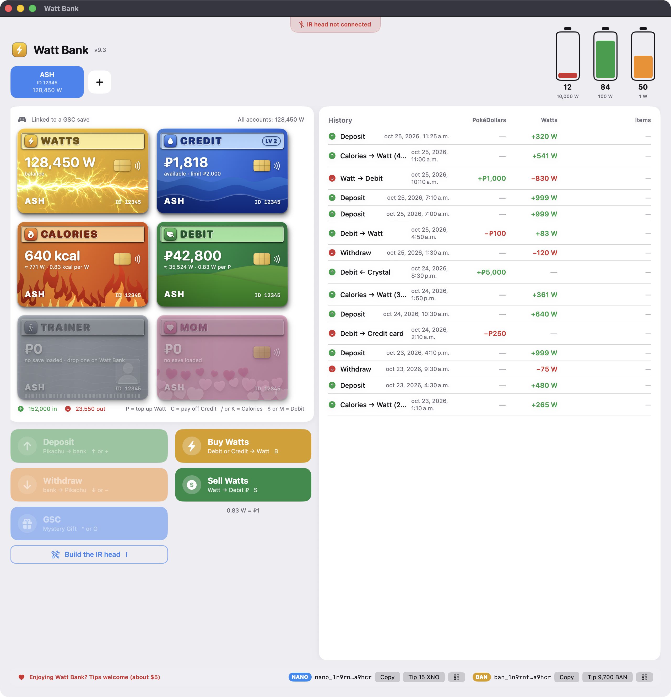

# ⚡ Watt Bank for Mac

A Bank for your Pikachu Watts, PokéDollars and exercise calories, built as a native macOS app.

Watt Bank stores the **watts** from a *Pokémon Pikachu 2 GS* (sent over infrared through a small ESP32 "IR head").
It turns your **Apple Health exercise calories** into watts and moves **PokéDollars** in and out of your Pokémon
game saves (every generation). It can also send **Mystery Gifts** to
Pokémon Gold, Silver and Crystal on your Game Boy Color or ModRetro Chromatic.



## Features

- **Cards:**

  | Card | What it holds |
  |---|---|
  | **Watts** | Watts |
  | **Debit** | PokéDollars, with no limit |
  | **Credit** | Loans in ₽. The limit doubles as you level up. |
  | **Calories** | Exercise from Apple Health |
  | **Trainer** | Live wallet in the loaded save, colored like the game (split diagonally when a save fits several games) |
  | **Mom** | Mom's savings in GSC and HeartGold/SoulSilver (shown only for those games) |

- **Infrared:**
  - **Deposit** watts from the Pikachu 2 GS.
  - **Withdraw** watts back to it.
  - **GSC** sends Mystery Gift items and decorations.
- **Game saves of every generation**, read and written through [PKHeX.Core](https://github.com/kwsch/PKHeX):
  - Drop a save anywhere on the window.
  - The same trainer name and ID always opens the same account.
  - A backup is made before every write.
- **Exchange:** buy Watts with Debit or Credit; sell Watts for Debit. 0.83 W = ₽1.
- **Calories → Watts** through an iPhone Shortcut that exports your Apple Health exercise.
- **History** with PokéDollar, Watt and Item columns.
- **Fully keyboard-driven** (see the shortcuts below).
- **Custom card art:** drop your own `Watt.png` or `Watt.pdf` (or `Debit`, `Credit`…) in
  `~/Library/Application Support/Watt Bank/Card Art/`. Templates are in [`card-art/`](card-art/).

## Requirements

- A Mac with Apple Silicon, running macOS 14 Sonoma or later.
- For the IR features: an ESP32 IR head (about $10 in parts). See **[Build the IR head](docs/ir-head.md)**.
  Watt Bank installs the firmware on the ESP32 itself, with one click; no Arduino IDE needed.
- For calories: an iPhone with the same Apple ID and iCloud Drive turned on.
  See **[the Health Sync Shortcut](docs/health-shortcut.md)**.

## Install

### Download

1. Download the latest `Watt-Bank-<version>-macOS.zip` from [Releases](../../releases) and unzip it.
2. Move **Watt Bank.app** to Applications.
3. The app isn't notarized. The first time, **right-click → Open → Open**. On newer macOS versions, go to
   System Settings → Privacy & Security → **Open Anyway** instead.
4. If the save-file features or the firmware installer get blocked, clear the download flag once:
   `xattr -dr com.apple.quarantine "/Applications/Watt Bank.app"`

### Build from source

You need the Xcode Command Line Tools (`xcode-select --install`). Building the save helper also needs the
[.NET 10 SDK](https://dotnet.microsoft.com/download).

```sh
git clone https://github.com/digitalnotenan/watt-bank.git
cd watt-bank/mac-app
./build.sh                      # builds build/Watt Bank.app (and the save helper, if .NET is installed)
open "build/Watt Bank.app"
```

Without .NET, the app still builds and runs. Save-file features stay off until `wbsave` is built.
The one-click firmware installer uses [esptool](https://github.com/espressif/esptool) (GPL-2.0-or-later). `build.sh`
takes it from the Arduino ESP32 core or Homebrew (`brew install esptool`). The firmware binaries are in
`firmware/build/`; `firmware/build.sh` rebuilds them with `arduino-cli`.

## Keyboard

| Key | Action | Key | Action |
|---|---|---|---|
| ↑ or + | Deposit (IR) | ↓ or − | Withdraw (IR) |
| G or * | GSC Mystery Gift | I | IR head guide |
| P | Top up Watt | B / S | Buy / Sell Watts |
| $ or M | Debit card | C | Pay off Credit |
| / or K | Calories card | ← → or 1–9 | Switch account |
| ⌘N | New account | ⌘⌫ | Delete empty account |

In every window: ↑ ↓ choose, ← → change the amount (or just type it), Return confirms and Esc closes.

## Repository layout

| Folder | What's inside |
|---|---|
| `mac-app/` | The SwiftUI app (`WattBank.swift`), `build.sh`, artwork and `wbsave/` (the save helper, C# with PKHeX.Core) |
| `firmware/` | ESP32 firmware for the IR head: Arduino source (`wattbank_ir/`), prebuilt binaries (`build/`), `build.sh` |
| `shortcuts/` | Signed iPhone Shortcut: *Watt Bank Health Sync* |
| `card-art/` | Card templates (SVG, background and foreground layers) |
| `docs/` | Guides |

## Where your data lives

| Path | Contents |
|---|---|
| `~/Library/Application Support/Watt Bank/bank.json` | Accounts, balances and history |
| `~/Library/Application Support/Watt Bank/Save Backups/` | A copy of every game save, taken before Watt Bank changes it |

## Support the project

If Watt Bank makes you smile, a tip of about **$5** is very welcome. The footer of the app has the addresses, QR
codes and a **Tip** button that opens your wallet with a suggested amount filled in. The amount follows the live
price, so it's always about $5, rounded to a clean number of coins (for example 15 XNO or 9,400 BAN). You can change it.

| Coin | Address |
|---|---|
| **NANO** | `nano_1n9rntp5r1z8iu7eqkkdr1y885z75mgweppompe5jm14yscot366f6za9hcr` |
| **BAN** | `ban_1n9rntp5r1z8iu7eqkkdr1y885z75mgweppompe5jm14yscot366f6za9hcr` |

## License and credits

- Released under the **GNU GPL v3.0** (see [LICENSE](LICENSE)).
- The save helper is built on [PKHeX.Core](https://github.com/kwsch/PKHeX) by Kaphotics and contributors,
  which is also GPL-3.0.
- The firmware installer runs [esptool](https://github.com/espressif/esptool) by Espressif (GPL-2.0-or-later).
- Tip amounts use prices from the [CoinGecko](https://www.coingecko.com) API.

Watt Bank is a fan project. It is not affiliated with, endorsed by or sponsored by Nintendo, Game Freak,
Creatures Inc. or The Pokémon Company. Pokémon and all related names are trademarks of their respective owners.
Editing save files always carries some risk: Watt Bank backs up every save before it writes, but keep your own
backups too.
