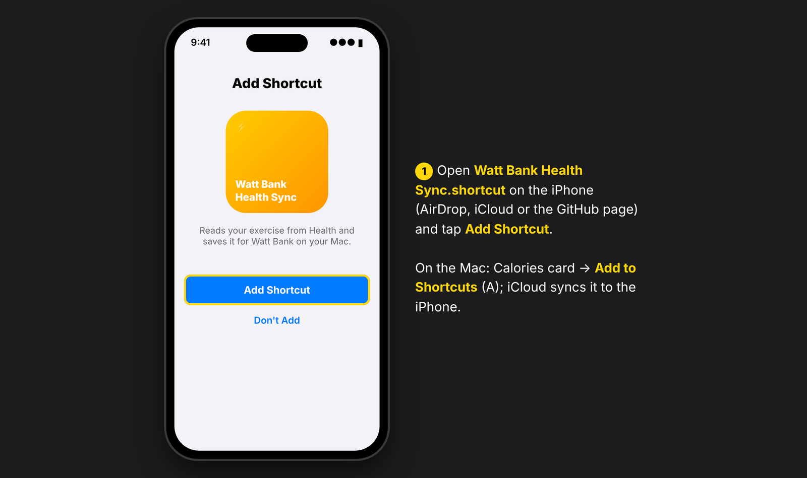
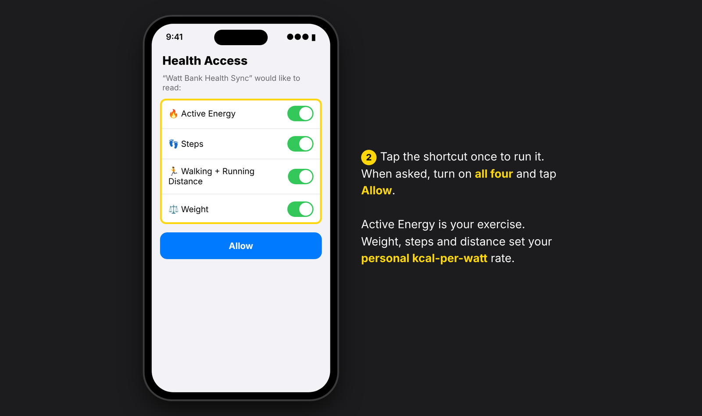
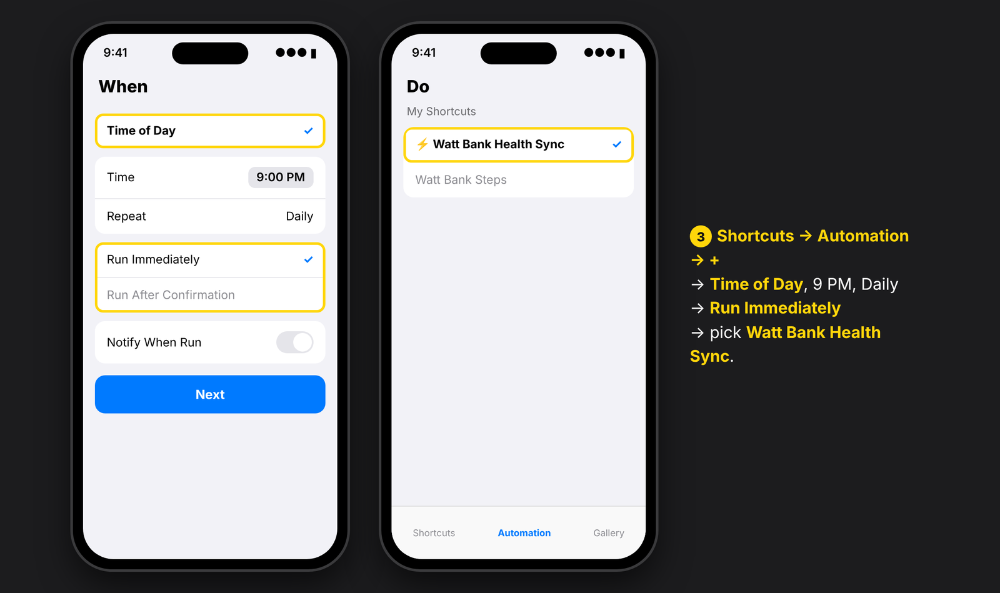
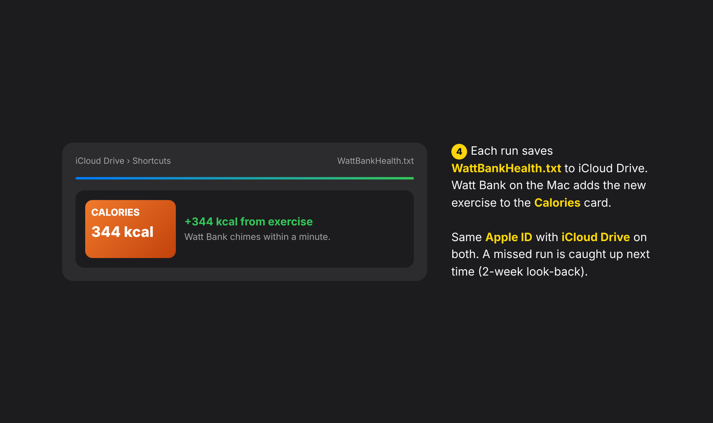

# The Health Sync Shortcut (Calories card)

The Calories card fills up from the exercise you record in Apple Health. A small iPhone Shortcut,
**Watt Bank Health Sync**, reads the last two weeks of Active Energy and saves them to iCloud Drive. Watt Bank
on the Mac picks up the file within a minute and adds any new kilocalories to the card. Calories are never
counted twice.

## Install

| 1. Add | 2. Allow Health |
|---|---|
|  |  |
| **3. Automate** | **4. Calories arrive** |
|  |  |

1. Install the Shortcut using one of these:
   - Open [`shortcuts/Watt Bank Health Sync.shortcut`](../shortcuts/) on your iPhone.
   - In Watt Bank, click the Calories card (or press **K**) and choose **Add to Shortcuts** (**A**). This
     imports it on the Mac, and iCloud syncs it to the iPhone.
   - Choose **Save a copy** and AirDrop the file to the iPhone.
2. Run it once on the iPhone and allow Health access:
   - **Active Energy**
   - **Steps**
   - **Walking + Running Distance**
   - **Weight**

   Weight, steps and distance are used to work out your personal kcal-per-watt rate. Without them, a standard
   rate is used.
3. Make it automatic. In **Shortcuts → Automation → + → Time of Day**, pick a time (for example 9 PM, daily),
   choose **Run Immediately**, and select **Watt Bank Health Sync**.

## Requirements and troubleshooting

- The iPhone and the Mac need the **same Apple ID** with **iCloud Drive** on. The file is
  `iCloud Drive/Shortcuts/WattBankHealth.txt`.
- No calories showed up? Run the Shortcut by hand and keep the phone online for a moment. iOS sometimes skips
  automations when the phone is locked or in Low Power Mode. Nothing is lost: each run looks back two weeks.
