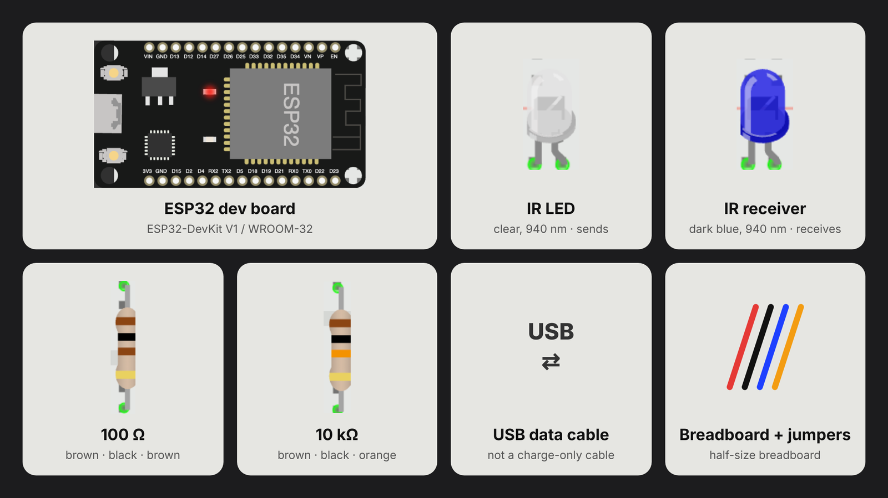
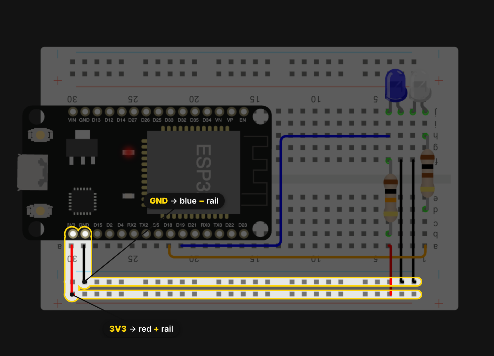
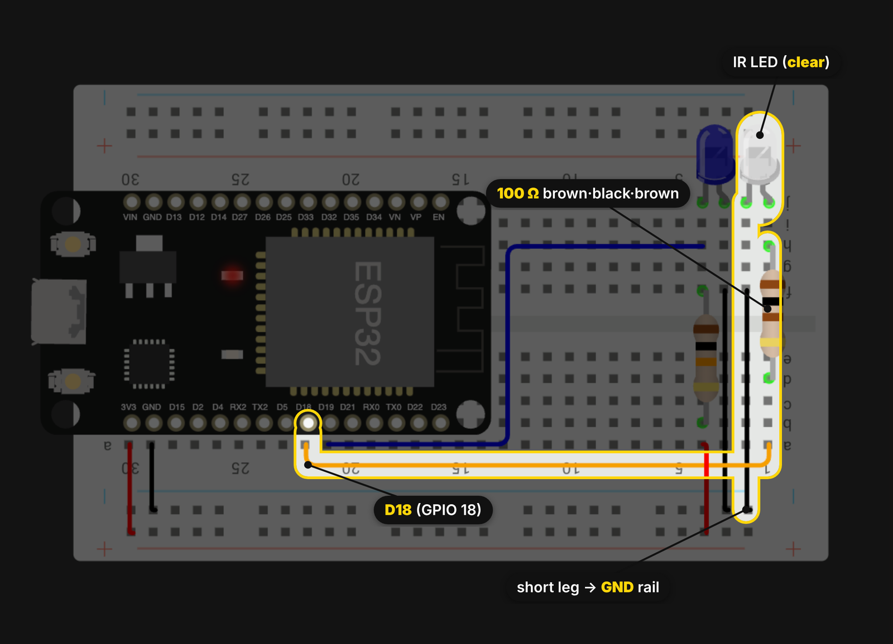
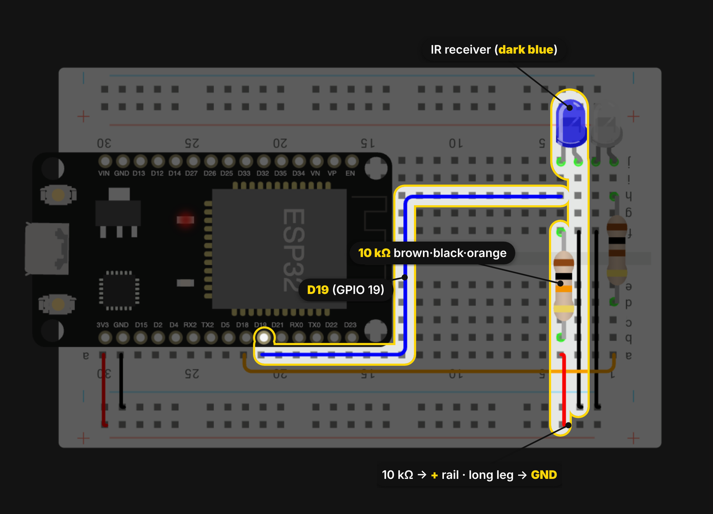
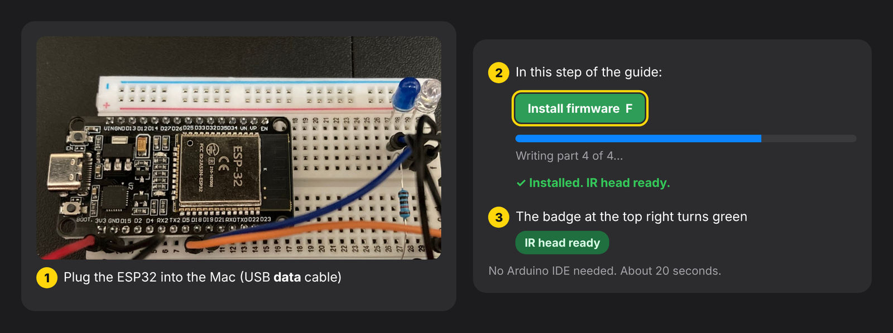
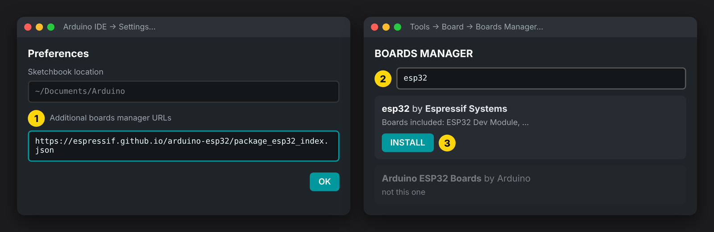
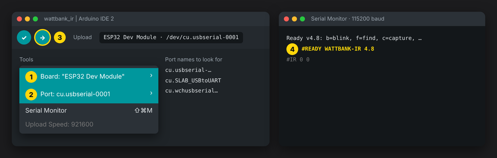
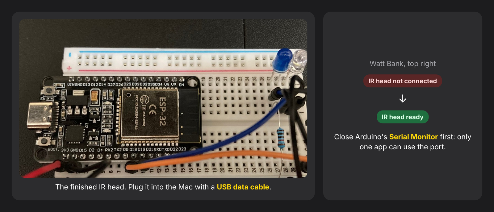
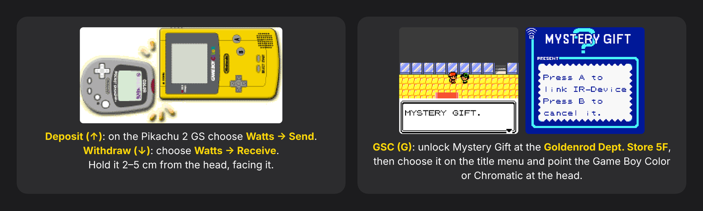
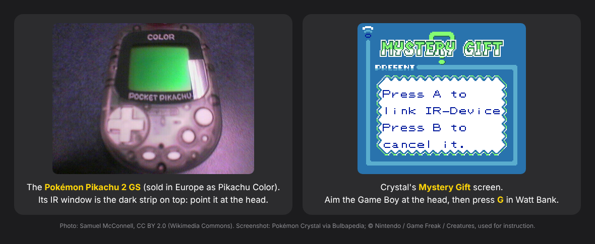

# Build the IR head

The IR head is an ESP32 with one infrared LED and one infrared light sensor. Watt Bank uses it over USB to talk to:

- a **Pokémon Pikachu 2 GS**, for deposits and withdrawals;
- a **Game Boy Color** or **ModRetro Chromatic**, for Mystery Gift with Pokémon Gold, Silver and Crystal.

The same guide is in the app: press **I** or click **Build the IR head**.

## 1. Parts



| Qty | Part | Notes |
|---|---|---|
| 1 | ESP32 dev board (ESP32-DevKit V1 / ESP32-WROOM-32) | Any board with a USB port |
| 1 | 940 nm infrared LED, 5 mm, **clear** | Sends |
| 1 | 940 nm infrared **receiver diode / phototransistor**, 5 mm, **dark blue** (the pair partner of the clear LED in IR LED kits) | Receives. **Not** a TV-remote receiver (TSOP/VS1838): the Pikachu and the Game Boy send plain light pulses, and those receivers ignore them. |
| 1 | 100 Ω resistor | For the LED |
| 1 | 10 kΩ resistor | Pull-up for the sensor |
| — | Breadboard, jumper wires, USB **data** cable | |

## 2. Wiring

### Power rails: 3V3 to the red + rail, GND to the blue − rail


### IR LED (sends): D18 → 100 Ω → clear IR LED → GND


### IR receiver (receives): D19 + 10 kΩ pull-up → dark-blue receiver → GND


If the receiver never reacts, turn it around (swap its legs).

### Schematic

```
              ESP32
          ┌───────────┐
          │      3V3  ├──────────┐
          │           │         10 kΩ
          │   GPIO 19 ├──────────┼──── collector (short leg) ┐
          │           │                                      │ IR phototransistor
          │       GND ├──────────┬──── emitter  (long leg)  ┘
          │           │          │
          │   GPIO 18 ├── 100 Ω ─┼──── anode (long leg)  ┐
          │           │          │                       │ IR LED, 940 nm
          │           │          └──── cathode (short leg, flat side) ┘
          └───────────┘
```

- **LED (sends):** GPIO 18 → 100 Ω → LED anode, and LED cathode → GND. That's about 20 mA, which is safe for the pin.
- **Sensor (receives):** 3.3 V → 10 kΩ → GPIO 19 → phototransistor collector, and emitter → GND.
  GPIO 19 reads **LOW** when it sees infrared light.
- Mount the LED and the sensor side by side, about 1 cm apart, pointing the same way.
- The board's own blue LED (GPIO 2) lights up when a strong IR signal arrives.

## 3. Install the firmware from Watt Bank (one click)



1. Plug the ESP32 into the Mac with a USB **data** cable.
2. In Watt Bank, press **I** (Build the IR head), go to step 5 and click **Install firmware** (or press **F**).
   If an ESP32 without the firmware is plugged in, the IR notch at the top center offers **Install** too.
3. In about 20 seconds the notch turns green: **IR head ready**.
   - If the board already runs the IR head firmware, its **blue light blinks** first, so you know which board is being written.
   - While it's being written, the board can't light anything. Watch the progress bar in the guide and the blue notch at the top center.
   - When it restarts with the new firmware, the blue light **blinks 3 times**: installed.

- Stuck at "Connecting"? Hold the board's **BOOT** button while you click Install.
- No board found? Install the USB driver for its chip: **CP210x** or **CH340**.

The next two sections are a **backup**, in case the one-click install doesn't work.

## Backup A. Install Arduino IDE and ESP32 support



1. Install [Arduino IDE 2](https://www.arduino.cc/en/software).
2. Go to **Arduino IDE → Settings → Additional boards manager URLs** and add:
   `https://espressif.github.io/arduino-esp32/package_esp32_index.json`
3. Go to **Tools → Board → Boards Manager**, search for "esp32" and install **esp32 by Espressif Systems**.
4. If the board's port never appears, install the USB driver for its chip. The chip name is printed near the
   USB connector: **CP210x** (Silicon Labs) or **CH340** (WCH).

## Backup B. Upload the firmware from Arduino IDE



1. Open [`firmware/wattbank_ir/wattbank_ir.ino`](../firmware/wattbank_ir/wattbank_ir.ino). In the app, the guide's
   **Save firmware source** button (or **S**) puts it in `Downloads/wattbank_ir/`.
2. Choose **Tools → Board → esp32 → ESP32 Dev Module**.
3. Choose **Tools → Port** and pick `cu.usbserial-…`, `cu.SLAB_USBtoUART` or `cu.wchusbserial…`.
4. Click **Upload**. If it hangs on `Connecting…`, hold the board's **BOOT** button until the upload starts.
5. Open **Tools → Serial Monitor** at **115200** baud. You should see `#READY WATTBANK-IR 4.8`.
6. **Close the Serial Monitor.** Watt Bank needs the port to itself.

## 4. Use it



1. Plug the ESP32 into the Mac. The IR notch at the top center of Watt Bank turns green.
2. Hold the device 2–5 cm from the LED and sensor, facing them straight on, away from sunlight.
   - **Deposit (↑):** on the Pikachu 2 GS choose **Watts → Send**.
   - **Withdraw (↓):** on the Pikachu choose **Watts → Receive**, then pick the amount in Watt Bank.
   - **GSC (G):** in Gold, Silver or Crystal choose **Mystery Gift** on the title menu (unlocked at the Goldenrod Dept. Store 5F) and point the
     Game Boy Color or Chromatic at the head.



What the real thing looks like:



<sub>Photo: [Samuel McConnell](https://commons.wikimedia.org/wiki/File:Pokemon_Pikachu_Color,_2006.jpg),
[CC BY 2.0](https://creativecommons.org/licenses/by/2.0/). Screenshot: Pokémon Crystal, via
[Bulbapedia](https://bulbapedia.bulbagarden.net/wiki/Mystery_Gift); © Nintendo / Game Freak / Creatures.</sub>

### Serial commands (for testing)

| Command | Action |
|---|---|
| `b` | Blink the IR LED |
| `f` | Blink the blue light (used by the installer) |
| `c` | Capture raw pulses |
| `d` | Deposit |
| `w<watts>` | Withdraw |
| `g<type>,<code>,<fallback>` | Mystery Gift |
| `x` | Cancel |
| `v` | Verbose mode |
| `?` | Identify |
